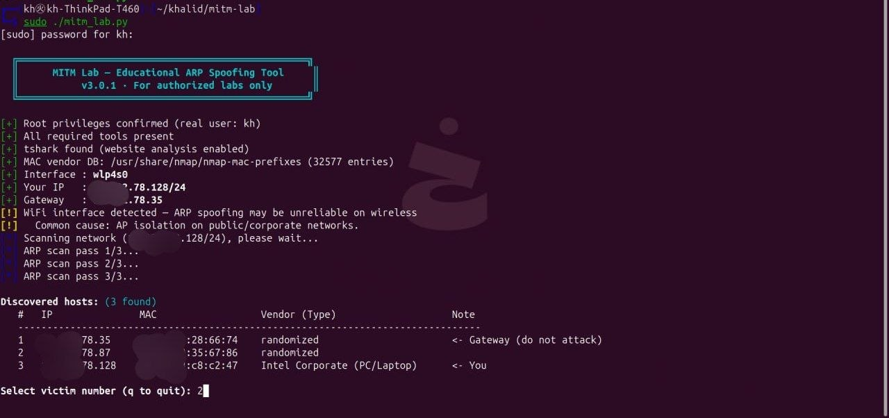
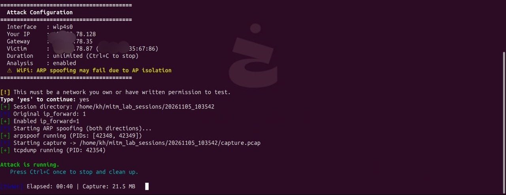
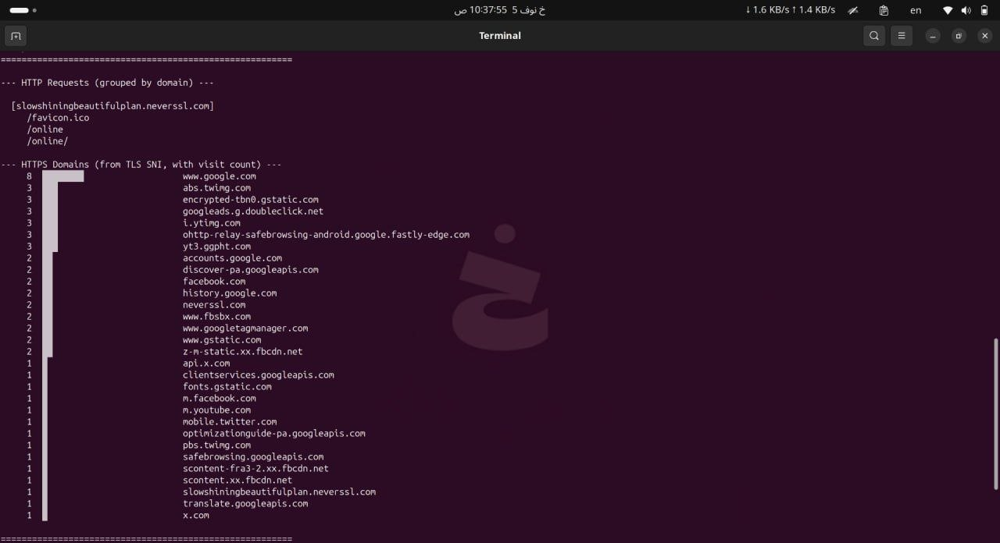

# MITM Lab — Educational ARP Spoofing & Network Analysis Tool

> ⚠️ **FOR AUTHORIZED LABS ONLY.** Use this tool exclusively on
> networks you own or have explicit written permission to test.
> Unauthorized network interception is illegal in most countries.

A Python-based educational security tool demonstrating **ARP Spoofing**
and **Man-in-the-Middle (MITM)** dynamics in a controlled environment —
highlighting what metadata remains visible and what stays protected
under TLS/HTTPS.



## 💡 About This Project

This is my first GitHub project. Built in **Python** with assistance
from AI assistants for review and hardening. Tested across controlled
lab environments to ensure clean execution and network restoration.

## ✨ Features

- 🔍 **Host Discovery** — Scans local subnet (`arp-scan` / `nmap`)
- 🏷️ **MAC OUI Lookup** — Resolves MAC → vendor + device type
- 🎭 **Bidirectional ARP Spoofing** — Full-duplex redirection (`arpspoof`)
- 📦 **Capture Management** — `tcpdump` with auto-rotation
- 🔬 **Traffic Analysis** — HTTP URLs + HTTPS SNI (`tshark`)
- 🛡️ **Automated Cleanup** — Restores ARP tables and routing on exit
- 🎓 **Educational Mode** — `--explain` for step-by-step learning

## 🎓 Learning Objectives

- **ARP Vulnerabilities** — Why lack of authentication allows impersonation
- **TLS Metadata Leakage** — Why SNI, timing, and volume remain visible
- **Modern Defenses** — Why HSTS and AP Isolation matter
- **Device Telemetry** — Why phones contact dozens of domains silently

> 💡 **Encryption Note:** This tool does **NOT** decrypt TLS/HTTPS.
> It strictly observes unencrypted metadata visible to passive monitoring.

## 🚀 Quick Start

### 1. Install Dependencies

```bash
sudo apt update
sudo apt install -y dsniff tcpdump nmap arp-scan iproute2 tshark ieee-data
```

### 2. Clone & Setup

```bash
git clone https://github.com/Khaled-Hisham/mitm-lab.git
cd mitm-lab
chmod +x mitm_lab.py
```

### 3. Pre-flight Check

Verify that all dependencies and permissions are correct:

```bash
sudo ./mitm_lab.py --check
```

### 4. Run the Lab

```bash
# Interactive mode (recommended for first use)
sudo ./mitm_lab.py

# Auto-pick first valid victim, run 5 minutes
sudo ./mitm_lab.py --auto --duration 300

# Target a specific host for 2 minutes
sudo ./mitm_lab.py --victim 192.168.1.42 --duration 120

# Educational mode (explains each step)
sudo ./mitm_lab.py --explain
```

## 📖 Usage

| Option | Description |
|--------|-------------|
| `--dry-run` | Show what would happen, don't attack |
| `--check` | Pre-flight checks only |
| `--auto` | Non-interactive victim selection |
| `--victim IP` | Target a specific host |
| `--duration N` | Auto-stop after N seconds |
| `--interface IF` | Override interface detection |
| `--gateway IP` | Override gateway detection |
| `--no-analyze` | Skip tshark analysis |
| `--wake` | Ping-sweep to wake sleeping hosts |
| `--explain` | Explain each step (educational) |
| `--version` | Show version |
| `--help` | Show help |

## 📊 Screenshots

### 1. Host Discovery

The tool scans the subnet and identifies vendors from MAC OUI:



### 2. Metadata Report

After stopping, a report shows HTTP URLs and HTTPS domains (from SNI):



## ⚙️ Requirements

| Tool | Purpose | Required? |
|------|---------|-----------|
| `arpspoof` (dsniff) | ARP spoofing | ✅ Yes |
| `tcpdump` | Packet capture | ✅ Yes |
| `nmap` or `arp-scan` | Network discovery | ✅ One |
| `iproute2` | Network config | ✅ Yes |
| `tshark` | Website analysis | ⚠️ Optional |
| `arping` | Fast recovery | ⚠️ Optional |
| `ieee-data` | MAC vendor lookup | ⚠️ Optional |

**Tested on:** Debian 12, Ubuntu 22.04/24.04, Kali Linux 2024.x
on x86_64 and ARM64.

## 🚫 Limitations

- **Does not break encryption.** HTTPS payloads remain unreadable.
- **WiFi AP isolation** may block ARP spoofing on public/corporate hotspots.
- **MIUI (Xiaomi)** and some Android ROMs aggressively kill background
  apps — you will see fewer domains from such devices. This is normal.
- **Randomized MACs** (iOS/Android) appear as `randomized` in vendor column.
- **Dynamic ARP Inspection (DAI)** on managed switches blocks ARP spoofing.
- **IPv6** is not supported (IPv4 only).

## 📁 Project Structure

```
mitm-lab/
├── README.md
├── LICENSE
├── .gitignore
├── mitm_lab.py              # Main tool (Python 3.8+)
├── docs/
│   ├── HOW_IT_WORKS.md      # Deep dive into ARP/MITM mechanics
│   ├── USAGE.md             # Full CLI reference
│   └── screenshots/
│       ├── scan.png
│       ├── discovery.png
│       └── analysis.png
└── examples/
    └── sample_report.txt    # Example output (synthetic data)
```

## 🤝 Contributing

This is a learning project. Suggestions and improvements are
welcome via Issues and Pull Requests. Please keep the **ethical
framing** and **educational purpose** intact.

When contributing:
- Test on a lab network (never on production).
- Maintain the legal warnings.
- Update screenshots if UI changes.

## ⚖️ Legal & Ethics

This tool is provided **strictly for educational purposes**.

- ✅ Use on networks you own (home lab, personal router, VM lab).
- ✅ Use in CTF competitions with explicit permission.
- ❌ Never use on public WiFi, corporate networks, or schools
  without written authorization.
- ❌ Never use to intercept, store, or share others' data.

**In many jurisdictions, unauthorized network interception is a
criminal offense** — including but not limited to:

- 🇺🇸 **CFAA** (Computer Fraud and Abuse Act) — United States
- 🇬🇧 **Computer Misuse Act** — United Kingdom
- 🇪🇺 **GDPR** + national laws — European Union
- 🇸🇦 **Anti-Cyber Crime Law** — Saudi Arabia
- Similar laws worldwide

**The author assumes no liability for misuse.**

## 📄 License

MIT License — see [LICENSE](LICENSE) for full text.

```
Copyright (c) 2026 <Your Name>

Permission is hereby granted, free of charge, to any person obtaining
a copy of this software and associated documentation files (the
"Software"), to deal in the Software without restriction...
```

## 🙏 Acknowledgements

- Developed with assistance from AI assistants for code scaffolding,
  review, and documentation.
- All design decisions, testing, and validation were performed by
  the author.
- Thanks to the open-source tools that make this possible:
  `arpspoof` (dsniff), `tcpdump`, `nmap`, `arp-scan`, `tshark`.

---

**⭐ If this project helped you learn, consider giving it a star!**
